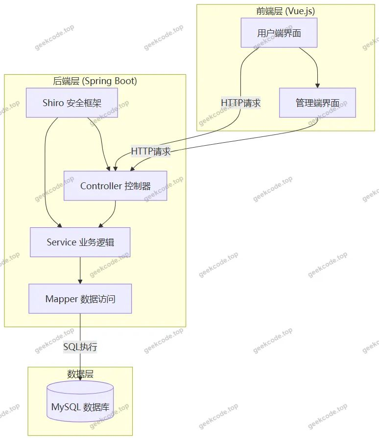
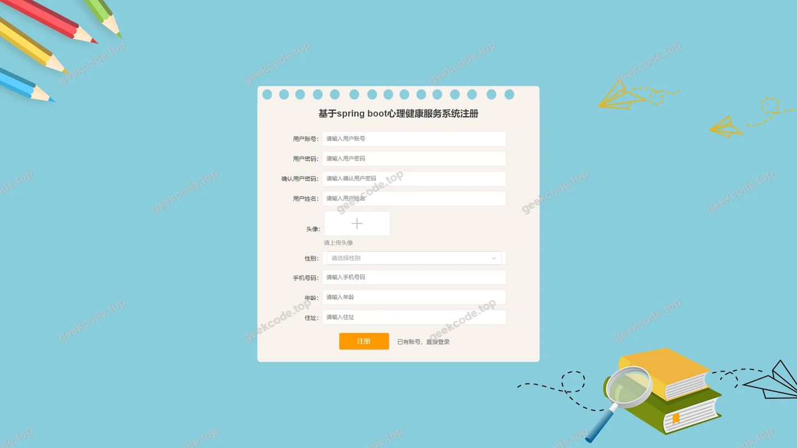
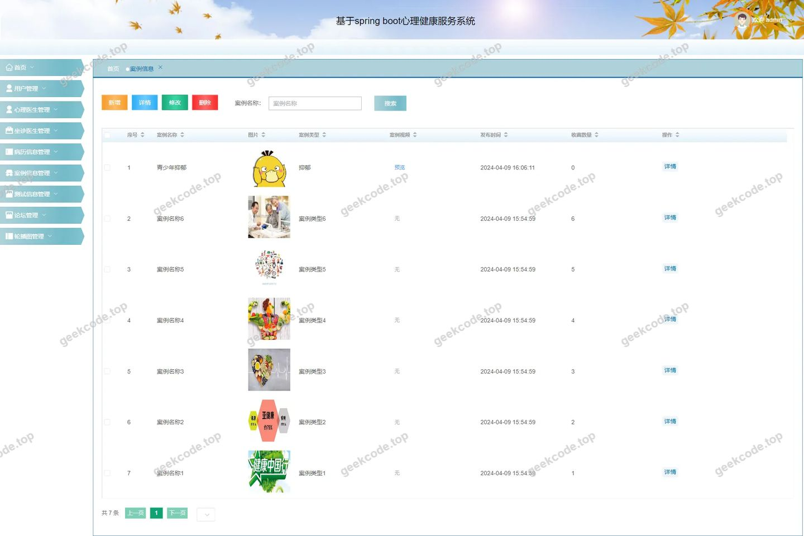
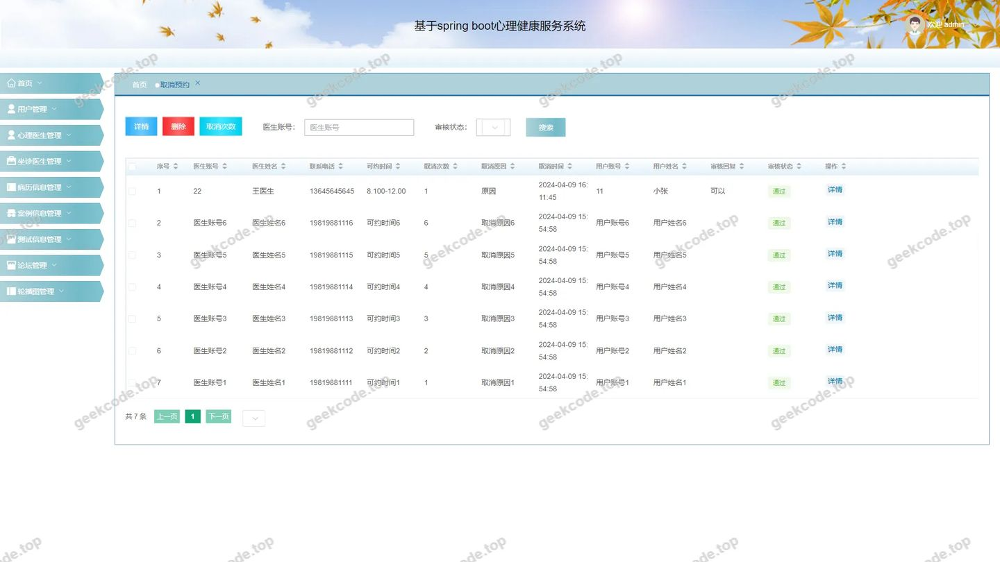
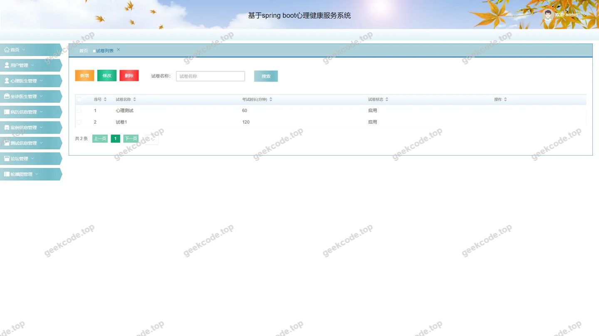
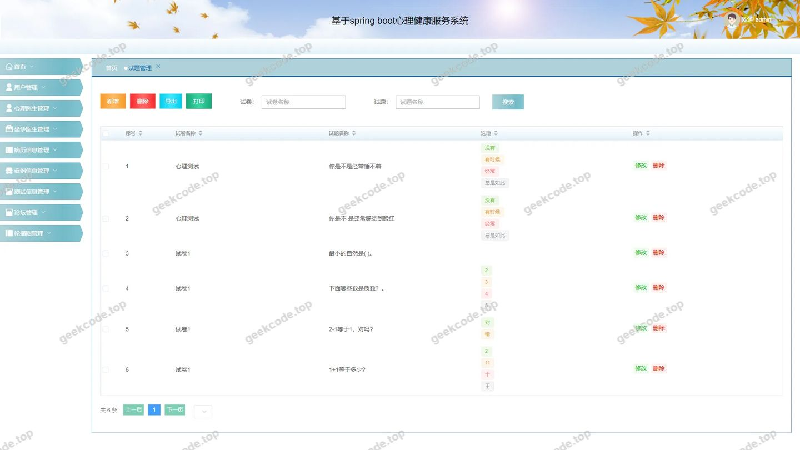
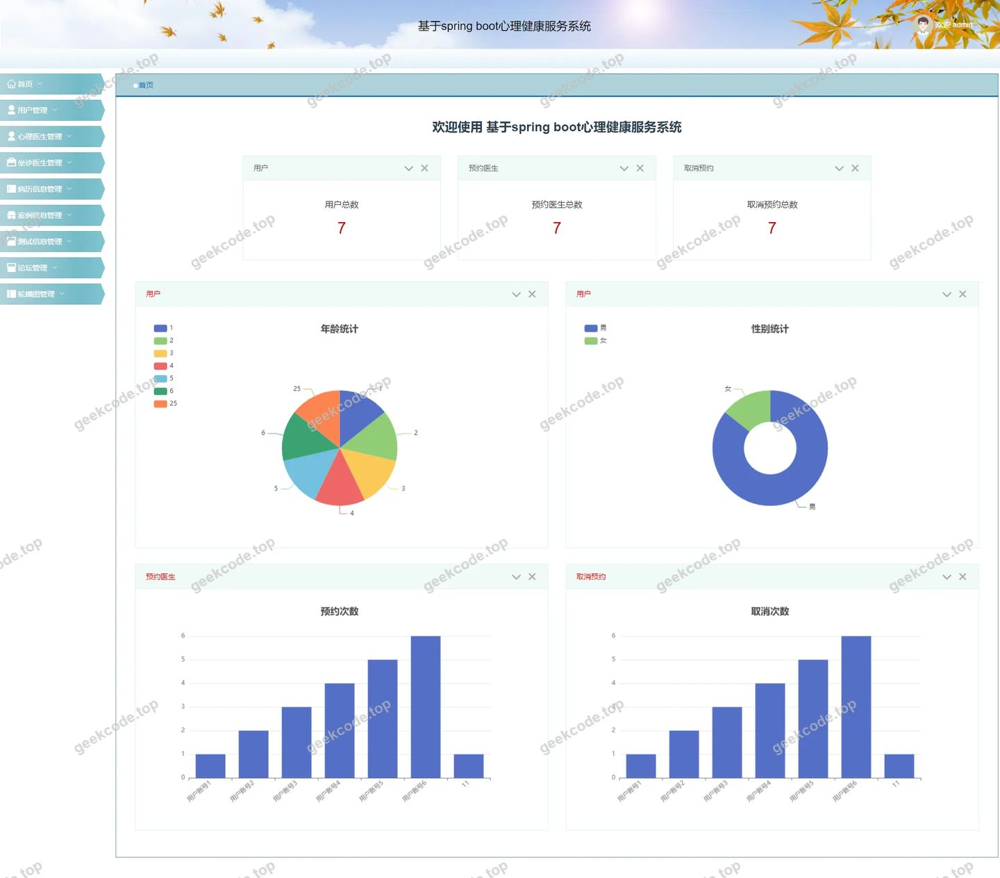
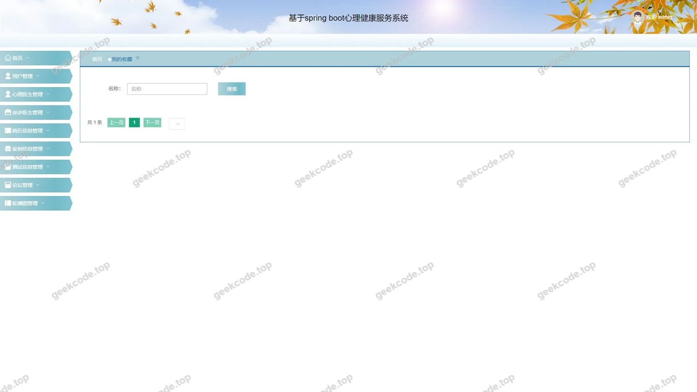
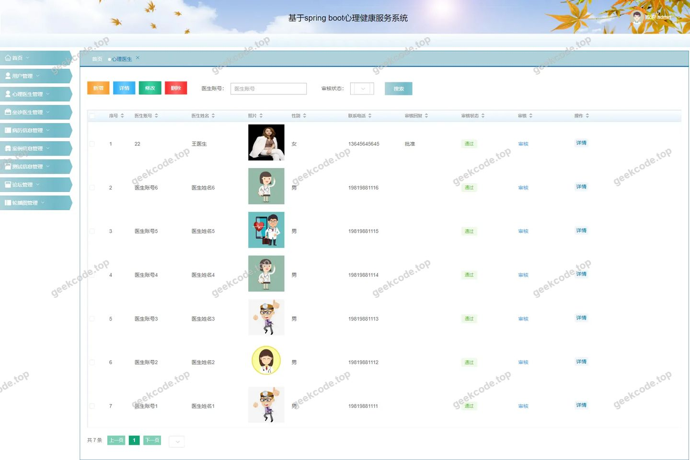

# 基于spring boot心理健康服务系统

> 🎓 **计算机毕业设计 · 基于spring boot心理健康服务系统**
>
> 本仓库只放**项目介绍 + 运行截图**（截图是站点带水印的原图，存在仓库 `images/` 里）。
>
> 👉 **完整可运行源码 / 数据库脚本 / 部署文档：[点我获取](https://geekcode.top/archives/%E5%9F%BA%E4%BA%8Espring-boot%E5%BF%83%E7%90%86%E5%81%A5%E5%BA%B7%E6%9C%8D%E5%8A%A1%E7%B3%BB%E7%BB%9F?utm_source=github)**
>
> 💬 咨询微信：**ir9372**　|　🌐 更多项目：[极客代码 geekcode.top](https://geekcode.top/?utm_source=github)
>
> 📌 项目详情页：<https://geekcode.top/archives/%E5%9F%BA%E4%BA%8Espring-boot%E5%BF%83%E7%90%86%E5%81%A5%E5%BA%B7%E6%9C%8D%E5%8A%A1%E7%B3%BB%E7%BB%9F?utm_source=github>

<table><td width="230" align="center"> <b>扫码加微信 ir9372</b></td><td valign="middle">📦 源码 = 项目介绍 + 全部运行截图 + 数据库 + 部署文档 👉 点上方任意截图，直接跳到 <b>极客代码 geekcode.top</b> 详情页</td></table>

---

<h1>基于spring boot心理健康服务系统</h1>
<h2>项目概述</h2>

本项目为“基于 Spring Boot 的心理健康服务系统”，旨在构建一个集心理医生预约、病例管理、在线测评及社区交流于一体的综合性服务平台。系统采用前后端分离架构，面向普通用户（患者）提供在线注册登录、浏览心理医生信息、发起就诊预约、查看个人收藏及参与论坛讨论等功能；面向管理员提供全面的后台管理能力，涵盖试题试卷管理、案例信息维护、用户与医生资料审核、预约记录处理及系统配置等核心业务。该技术栈组合有效解决了传统线下心理咨询资源分配不均、信息不对称及管理效率低下的问题，适用于高校心理健康教育中心、社会心理咨询机构或企业内部员工帮助计划（EAP）场景，通过数字化手段提升心理健康服务的可及性与专业度。

<h2>技术架构</h2>
<h3>1. 总体架构设计</h3>

系统采用典型的 B/S（浏览器/服务器）架构，遵循 MVC 设计模式，分为表现层、业务逻辑层和数据持久层。前端使用 Vue.js 框架实现单页面应用（SPA），后端基于 Spring Boot 框架构建 RESTful API 接口，两者通过 HTTP 协议进行数据交互。

<h3>2. 核心技术选型理由</h3>
<ul>
<li><strong>Spring Boot</strong>: 作为核心后端框架，利用其自动配置和起步依赖特性，快速搭建稳定、高效的服务端环境，简化了传统 Spring 应用的繁琐配置。</li>
<li><strong>MyBatis-Plus</strong>: 在 MyBatis 基础上增强，提供了通用的 CRUD 操作和条件构造器，大幅减少了样板代码，提升了开发效率，同时保留了 SQL 的灵活性以应对复杂查询。</li>
<li><strong>Apache Shiro</strong>: 用于权限管理和身份认证。相比 Spring Security，Shiro 更轻量且易于集成，能够灵活控制不同角色（如管理员、普通用户、心理医生）对后台路由和前台功能的访问权限，确保系统安全性。</li>
<li><strong>MySQL</strong>: 作为关系型数据库存储用户信息、医生档案、预约记录、试题库及论坛帖子等结构化数据，具备高可靠性和成熟的事务支持机制。</li>
</ul>
<h3>3. 数据库设计要点</h3>

根据源码中的实体类命名（如 <code>xinliyisheng</code>, <code>yonghu</code>, <code>examquestion</code> 等），数据库主要包含以下核心表结构：

<ul>
<li><strong>用户域</strong>：包括普通用户表 (<code>yonghu</code>) 和心理医生表 (<code>xinliyisheng</code>)，存储账号、密码、个人信息及资质详情。</li>
<li><strong>业务域</strong>：包括预约表 (<code>yuyueyisheng</code>)、取消预约记录 (<code>quxiaoyuyue</code>)、坐诊医生关联表 (<code>zuozhenyisheng</code>) 及医生就诊记录 (<code>yishengjiuzhen</code>)，处理核心的诊疗流程数据。</li>
<li><strong>内容域</strong>：包括病例信息表 (<code>binglixinxi</code>)、案例信息表 (<code>anlixinxi</code>)、案例类型表 (<code>anlileixing</code>) 及论坛帖子表 (<code>forum</code>)，用于知识分享与交流。</li>
<li><strong>测评域</strong>：包括试题表 (<code>examquestion</code>)、试卷表 (<code>exampaper</code>)、考试记录表 (<code>examrecord</code>) 及失败记录表 (<code>examfailrecord</code>)，支撑在线心理测评功能。</li>
<li><strong>辅助域</strong>：包括收藏表 (<code>storeup</code>) 和系统配置表 (<code>config</code>)，用于个性化服务和参数管理。</li>
</ul>
<h2>功能模块</h2>
<h3>1. 前台用户端</h3>

前台主要面向注册用户（患者/咨询者）和心理医生，提供自助式服务入口。

<ul>
<li><strong>首页与信息展示</strong>：展示系统公告、热门心理医生推荐及最新案例资讯。</li>
<li><strong>用户管理</strong>：</li>
<li><strong>注册与登录</strong>：新用户填写基本信息完成注册，已有用户通过账号密码登录。</li>
<li><strong>个人中心</strong>：修改个人资料、查看账户状态。</li>
<li><strong>心理医生服务</strong>：</li>
<li><strong>医生列表与详情</strong>：浏览所有入驻的心理医生，查看医生的简介、擅长领域、职称及评价信息。</li>
<li><strong>预约挂号</strong>：选择特定医生和时间段发起就诊预约，并可查看历史预约记录。</li>
<li><strong>取消预约</strong>：针对未完成的预约申请取消操作，生成取消记录。</li>
<li><strong>学习与测评</strong>：</li>
<li><strong>在线测评</strong>：参与系统提供的心理测试试卷，查看测试结果及历史记录。</li>
<li><strong>案例学习</strong>：浏览各类心理健康案例信息及分类，获取专业知识。</li>
<li><strong>互动社区</strong>：</li>
<li><strong>论坛交流</strong>：查看帖子列表，参与话题讨论。</li>
<li><strong>我的收藏</strong>：管理用户收藏的医生、文章或案例。</li>
</ul>
<h3>2. 后台管理端</h3>

后台面向系统管理员，提供全维度的数据管理与业务监控能力。

<ul>
<li><strong>基础信息管理</strong>：</li>
<li><strong>用户管理</strong>：查看、编辑、删除普通用户信息，重置密码。</li>
<li><strong>心理医生管理</strong>：审核医生注册信息，维护医生档案，管理医生排班（坐诊医生）。</li>
<li><strong>业务运营管理</strong>：</li>
<li><strong>预约管理</strong>：查看所有用户的预约记录，处理预约状态，管理取消预约的申请。</li>
<li><strong>就诊记录管理</strong>：查看和管理医生接诊的详细记录。</li>
<li><strong>内容资源管理</strong>：</li>
<li><strong>案例信息管理</strong>：发布、编辑和删除心理健康案例，管理案例分类标签。</li>
<li><strong>论坛管理</strong>：审核和管理论坛帖子，维护社区秩序。</li>
<li><strong>收藏管理</strong>：查看用户的收藏数据，用于分析用户偏好。</li>
<li><strong>测评系统管理</strong>：</li>
<li><strong>试题管理</strong>：录入、修改、删除心理测评题目，设置选项与正确答案。</li>
<li><strong>试卷管理</strong>：组装试题生成试卷，设置考试时间、总分及格线等参数。</li>
<li><strong>考试记录管理</strong>：查看用户的答题得分、详细作答情况及不及格记录，导出数据报表。</li>
<li><strong>系统配置</strong>：</li>
<li><strong>参数设置</strong>：配置系统名称、Logo、轮播图等全局参数。</li>
</ul>
<h2>用户角色与权限</h2>

系统基于 Apache Shiro 实现细粒度的权限控制，主要划分为两类角色：

<h3>1. 普通用户（患者/访客）</h3>
<ul>
<li><strong>权限范围</strong>：仅限前台功能访问。</li>
<li><strong>具体功能</strong>：</li>
<li><strong>必须登录才能访问</strong>：个人中心、发起预约、取消预约、提交论坛帖子、收藏内容、参与在线测评。</li>
<li><strong>公开访问</strong>：首页浏览、查看医生列表及详情、查看案例信息、浏览论坛帖子、查看医生坐诊时间。</li>
<li><strong>限制</strong>：无法进入后台管理系统，无法修改他人数据，无法管理试题和试卷。</li>
</ul>
<h3>2. 系统管理员</h3>
<ul>
<li><strong>权限范围</strong>：拥有最高权限，可访问全部后台路由及部分前台调试功能。</li>
<li><strong>具体功能</strong>：</li>
<li><strong>全量数据管理</strong>：对用户、心理医生、预约记录、就诊记录、案例信息、论坛帖子拥有增删改查权限。</li>
<li><strong>测评体系掌控</strong>：独立管理试题库、试卷生成逻辑，并可查阅所有用户的考试记录和失败原因。</li>
<li><strong>系统运维</strong>：修改系统配置文件，管理后台菜单可见性。</li>
<li><strong>特殊入口</strong>：可通过 <code>/xinliyishengRegister</code> 路由直接添加新的心理医生账号（通常由管理员代为注册或审核）。</li>
</ul>
<h2>项目特色与创新点</h2>
<ol>
<li><strong>闭环的心理健康服务流程</strong>：系统不仅提供了传统的“医生-患者”预约匹配功能，还创新性地引入了“在线测评”模块。用户可以先通过标准化的心理试卷进行自我筛查，再根据结果预约合适的心理医生，实现了从“预防筛查”到“精准干预”的服务闭环。</li>
<li><strong>多维度的案例知识库</strong>：区别于普通的挂号系统，本项目建立了丰富的“案例信息”与“病例信息”库，并按“案例类型”进行分类。这不仅为患者提供了科普教育渠道，也为心理医生提供了参考素材，增强了系统的学术价值和教育意义。</li>
<li><strong>灵活的权限与安全机制</strong>：结合 Shiro 框架，系统在保障用户隐私（如病历、预约详情）的前提下，实现了管理员与普通用户的功能隔离。特别是在测评环节，记录了“考试失败记录”，有助于管理员分析题目的难度分布和用户群体的普遍心理特征，为优化测评模型提供数据支持。</li>
<li><strong>高效的后台管理体验</strong>：基于 MyBatis-Plus 的代码生成器和通用 Mapper，后台管理端实现了对十余种业务实体的标准化 CRUD 操作，界面简洁统一，降低了管理员的学习成本和维护复杂度。</li>
</ol>
<h2>部署环境</h2>

为确保系统正常运行，需准备以下软硬件环境：

<ul>
<li><strong>操作系统</strong>：Windows 10/11, Linux (CentOS 7+, Ubuntu 18.04+), macOS。</li>
<li><strong>Java 运行环境</strong>：JDK 1.8 或 JDK 11（推荐 JDK 1.8，兼容性好）。</li>
<li><strong>数据库</strong>：MySQL 5.7 或 MySQL 8.0。需创建对应的数据库实例并导入初始化 SQL 脚本。</li>
<li><strong>Web 服务器</strong>：内置 Tomcat（Spring Boot 自带），生产环境建议配合 Nginx 反向代理。</li>
<li><strong>前端构建工具</strong>：Node.js (版本 &gt;= 12.x)，npm 或 yarn。用于编译 Vue 前端代码。</li>
<li><strong>开发工具</strong>：IntelliJ IDEA 或 Eclipse（后端开发），VS Code 或 WebStorm（前端开发）。</li>
<li><strong>浏览器</strong>：Chrome, Firefox, Edge 等现代主流浏览器。</li>
</ul>
<h2>五、技术特性</h2>
<ul>
<li>前后端集成部署，前端资源打包至后端 static 目录</li>
<li>使用 MyBatis-Plus 简化数据访问层开发</li>
<li>集成 Shiro 权限框架实现角色权限控制</li>
</ul>
<h2>六、功能模块截图</h2>
<h3>前台用户端</h3>
<h4>前台-首页</h4>

<h4>前台-登录</h4>

<h4>前台-用户注册</h4>

<h3>后台管理端</h3>
<h4>后台-案例信息</h4>

<h4>后台-登录页</h4>

<h4>后台-取消预约</h4>

<h4>后台-试卷列表</h4>

<h4>后台-试题管理</h4>

<h4>页面-首页</h4>

<h4>后台-我的收藏</h4>

<h4>后台-心理医生</h4>

---

## 获取完整源码

| 项目 | 说明 |
| --- | --- |
| 项目名 | 基于spring boot心理健康服务系统 |
| 运行截图 | 本文 12 张（站点带水印原图，仓库 `images/` 目录） |
| 完整源码 | [https://geekcode.top/archives/%E5%9F%BA%E4%BA%8Espring-boot%E5%BF%83%E7%90%86%E5%81%A5%E5%BA%B7%E6%9C%8D%E5%8A%A1%E7%B3%BB%E7%BB%9F?utm_source=github](https://geekcode.top/archives/%E5%9F%BA%E4%BA%8Espring-boot%E5%BF%83%E7%90%86%E5%81%A5%E5%BA%B7%E6%9C%8D%E5%8A%A1%E7%B3%BB%E7%BB%9F?utm_source=github) |
| 咨询微信 | **ir9372**（备注：jingpin-yuanma） |
| 更多项目 | [极客代码 geekcode.top](https://geekcode.top/?utm_source=github) |

> 需要源码、部署、改配置、跑不起来等问题，加微信 ir9372 沟通，说明项目名即可。
